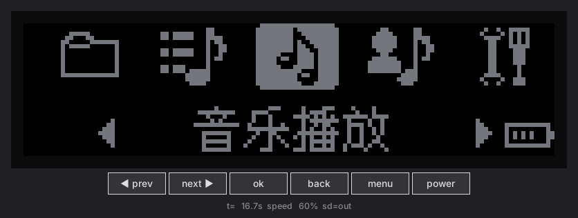
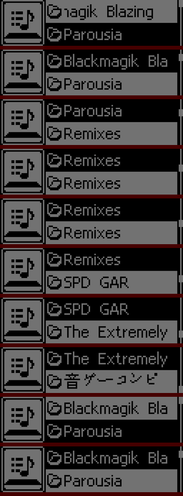
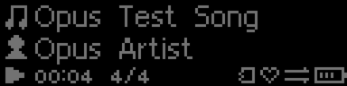

# nanitecfw2

Custom firmware mods for the **SNOWSKY (FiiO) ECHO NANO**, firmware **V2.0.0** (`NANOV200.IMG`),
and the emulator they were built and tested in.

It started as a port of [nanitecfw](https://github.com/maaraneasi/nanitecfw), which patches V1.7.0,
to V2.0.0. It then grew a Navidrome-style library, a faster library refresh and Opus playback.

> Not affiliated with FiiO or SNOWSKY. This repo holds only patch scripts, sources and tools, not
> firmware. You build the image yourself from the official file. Code mods can brick a player: read
> [Recovery](#recovery) before flashing. Use at your own risk.

> **If you flashed a build from before 2026‑11‑26:** it has a bug that crashes any file
> create/rename/delete on the player. Updating from it loops (see [Recovery](#recovery)); install
> the current build as described in [Upgrading from an older build](#upgrading-from-an-older-build).



## Features

| Feature | Mod | Details |
|---|---|---|
| **Navidrome-style library**: albums grouped by ALBUM + ALBUMARTIST, titles from tags, `ALBUM ARTIST` / `ALBUM_ARTIST` read, `A; B` artists listed under A, first value wins for repeated tags, `.cue` sheets ignored (a stock bug made them shift every album after them onto the wrong songs; Settings switch back to Stock) | navilib | [docs](mods/README.md#navilib-navidrome-style-library-for-the-echo-nano-v200) |
| **Skip unsupported tracks** silently instead of a popup | nanitec | [docs](mods/README.md#nanitec-fixes-ported-from-nanitecfw) |
| **Fixes a stock crash after a library refresh**: holding next/prev once the screen had timed out jumped into unloaded code and rebooted the player | nanitec | |
| **Shuffle** and **Random Album** main-menu items | nanitec | |
| **Hold-to-scroll acceleration** in library lists | nanitec | |
| **Power saving** switch in System Settings (lower decode clocks, CPU sleeps between events, slower wheel polling); used to be the separate `--power` image | navilib | [docs](mods/README.md#settings) |
| About shows `2.0.0m` | nanitec | |
| **Faster library refresh** (sector cache: −81% device reads) and faster boot logo | turbo | [docs](mods/README.md#turbo-faster-library-refresh-and-boot) |
| **Opus playback**: `.opus` browsed, scanned, tagged and played on FAT32 and exFAT cards (fixed-point libopus CELT decoder in the Ogg codec image); listed under Settings → Music support | opus | [docs](mods/README.md#opus-opus-playback) |
| **Faster Ogg/Opus tag scan**: the stock comment parser no longer re-reads tag padding up to 512 times per file | opus | |
| Recovery image (stock code, newer date) | nanitec `--recovery` | |

|  |  |  |
|---|---|---|

Everything was tested in the emulator: UI, library scans, updates, and the audio captured from the
emulated I²S compared against reference decodes. Every build is checked by `tools/cavecheck.py`:
no byte the mods overwrite may be referenced by live stock code.

## Requirements

- FiiO's official **V2.0.0** `NANOV200.IMG` (2026‑10‑29), SHA‑256
  `e60ddde7ceae9c83f95db7710f4633a31cf72295d4821128274718dec16ff993`.
- Python 3 (developed with 3.13). Building the images needs only the standard library. The emulator and tools need
  `pip install -r requirements.txt`.
- Only for rebuilding the bundled machine code (`--rebuild`): `clang` and `ld.lld` (thumbv7m), the
  libopus source (see `mods/opus/build.sh`) and `keystone-engine`. Prebuilt bytes are included, so
  you don't need any of this to build the images.

## Build

```sh
./build.sh NANOV200.IMG            # writes out/
```

| Output | Contents | Date |
|---|---|---|
| `out/NANOV200_mod.IMG` | navilib + nanitec + turbo + opus | 2026‑10‑31 |
| `out/NANOV200_recovery.IMG` | unmodified V2.0.0 code | 2026‑10‑31 |

Each mod also runs on its own, on stock or on another mod's output (`python3 mods/<mod>.py IN.IMG
OUT.IMG`). Every script checks the original bytes at each patch site and refuses an image it doesn't
recognize. When `capstone` is installed, `build.sh` also runs `tools/cavecheck.py` on the results
and fails if any overwritten byte is still used by the firmware.

## Install

1. Rename the image to `NANOV200.IMG` and copy it to the **root of the player's internal storage**,
   not the microSD card and not a folder. Case doesn't matter. At boot V2.0.0 looks for
   `NANOV100.IMG` … `NANOV399.IMG` (or `NANOV001.IMG`) in that root, and nowhere else.
2. Eject, unplug, then power off fully (hold power) and power on. The check runs while it boots.
   The player shows 系统升级中 / 请勿关机! ("system upgrading, don't power off") while it writes both
   firmware copies, **deletes the file**, and restarts.
3. Check that it took: About shows `2.0.0m`, and the main menu has Shuffle and Random Album.
4. Run **Media library → Update media library** once. navilib changes the database layout, and
   `.opus` files need scanning.

The updater only checks the `RKnanoFW` tag and that the header copy matches. It writes the second
firmware copy, copies it over the first, then deletes the file. If the file is still there after a
reboot and the player booted normally, it never found the file (wrong folder, or the SD card). If
About still says `2.0.0`, the update didn't take.

Dates don't matter. The boot scan and the updater install any `NANOVnnn.IMG`, and FiiO's boot
loader always starts a valid copy 1 without comparing dates (see
[FIRMWARE_NOTES](docs/FIRMWARE_NOTES.md)). A build dated 2026‑11‑01 was once reported not to
install, but replaying it on the real player's flash layout works, so that attempt failed for
another reason. So `build.sh` dates every image
**2026‑10‑31**. Observed on real players:
- 10‑30 installed over stock (10‑29);
- 10‑31 installed over 10‑30 and over another 10‑31.

10‑31 over stock follows the same later-day-same-month pattern. `DATE=… RDATE=… ./build.sh …`
changes the date, but untested dates are a risk.

### Upgrading from an older build

Builds made before 2026‑11‑26 overwrote a constant pool that the firmware's file-delete code uses,
so the old updater crashes right after it has written the new firmware, before it can delete the
file. Install the current build normally anyway. The player shows the update screen, restarts,
and runs the update a second time, now with the fixed code. That second run deletes the file, and
the player starts normally. If it keeps updating after that, use [Recovery](#recovery).

## Recovery

**Back to stock:** flash `out/NANOV200_recovery.IMG` the same way. It's FiiO's code, dated
2026‑10‑31.

**Stuck in an update loop or not booting:** the boot loader has a USB recovery mode that the
firmware can't break.
1. Connect the player to a computer or to a phone over USB-OTG, and hold **forward + back** (the
   two skip keys) until a Rockchip device appears: `lsusb` shows `2207:262d`. The screen stays
   off in this mode.
2. Run `tools/echofix.py`. It needs Python 3 and root, and nothing else: no libusb, no pip. It
   talks to the device straight through Linux usbfs. On a rooted Android phone in Termux:

   ```sh
   pkg install python
   su -c "$PREFIX/bin/python echofix.py info"     # read-only: both firmware copies + the storage root
   su -c "$PREFIX/bin/python echofix.py fix"      # renames NANOV*.IMG -> .BAK (one directory sector)
   su -c "$PREFIX/bin/python echofix.py fallback" # see below
   su -c "$PREFIX/bin/python echofix.py dumpdb"   # read-only: media library database -> echodb.gz
   su -c "$PREFIX/bin/python echofix.py reboot"
   ```

   On a Linux PC, use `sudo python3 tools/echofix.py …`.

   `fix` saves the sector it changes to `echofix-backup-*.bin` first, reads it back to check it,
   and refuses to write anything if firmware copy 1 looks damaged.

   `info` also shows where the boot loader's fallback lands. Players flashed at the factory keep a
   stale header from that first flash between the two copies. The loader stops at it, so it never
   falls back to the real second copy. `fallback` clears that one sector the same careful way. It
   only acts when both firmware copies are complete and the stale copy is broken.
3. If a firmware copy itself is damaged, rewrite copy 1 from a stock `NANOV200.IMG` with
   `rkdeveloptool`. Copy 1 is at LBA 0. Write the image's first 11 MiB (`0xB00000` bytes) there in
   16-sector chunks and read each one back, as in TheMVS's
   [Echo Mini recovery](https://github.com/TheMVS/snowsky-echo-mini-recovery). Never use
   `rkdeveloptool ef`.

For the internal storage layout (firmware copies, raw data area, user FAT), see
[docs/FIRMWARE_NOTES.md](docs/FIRMWARE_NOTES.md#internal-storage-updates-and-recovery).

## Known limits

- The library stops at **8,192 songs** (a V2.0.0 limit). Files beyond that, in FAT directory order,
  are skipped.
- **Opus**: only CELT mode, which is what encoders produce for music at about 64 kbit/s stereo and
  up. Speech/low-bitrate (SILK/hybrid) files are refused, and multichannel isn't supported. Tags
  stored after a large embedded cover aren't read (the same as stock Ogg Vorbis).
- Power saving (System Settings) runs, but its battery gain hasn't been measured on hardware, and
  it's untested with hi-res (24/192) files.
- nanitecfw's library-refresh C code (5× faster refresh, Recent Albums, `CFWLOG.TXT`) isn't ported
  yet. See the [ideas backlog](mods/README.md#ideas-backlog-not-built-yet).

## Emulator

```sh
pip install -r requirements.txt
python3 echonano.py run NANOV200.IMG --sd sd.img --sd-music ~/Music/some-folder
python3 echonano.py script out/NANOV200_mod.IMG examples/demo.txt --audio-out play.wav
```

It runs both cores: the main core and the HiFi core running the real codec image. It also covers
the OLED, keys, eMMC, microSD, mailbox and DMA → I²S, so you can boot any image, use it from the
keyboard and record what it shows and plays. See [docs/EMULATOR.md](docs/EMULATOR.md) and the
image unpack/pack workflow in `fwtool.py`.

## Repository layout

| Path | What |
|---|---|
| `build.sh` | builds the two images from the official file |
| `mods/` | `navilib.py`, `nanitec.py`, `turbo.py` (+ `turbo/cache.c`), `opus.py` (+ `opus/`: decoder glue, build, `bench.py`), [`README.md`](mods/README.md) with what each mod patches and how it was tested |
| `echonano.py`, `emu/` | the emulator |
| `fwtool.py`, `rkfw.py`, `rkcrc.py`, `fwmem.py`, `mkdisk.py` | image unpack/pack/patch/CRC, eMMC/SD image helpers |
| `tools/fwre.py` | disassembly / reference search for the firmware |
| `tools/cavecheck.py` | proves no live code references the bytes a build overwrites (run by `build.sh`) |
| `tools/echofix.py` | RockUSB Loader-mode rescue: inspect the firmware copies, rename a stuck update file, copy the media database (`dumpdb`) |
| `tools/dbcheck.py` | checks a media database (from `echofix.py dumpdb` or an emulator image): does every album open the songs it should |
| `tools/navicheck.py` | predicts the navilib Album list from a music folder's tags |
| `tools/settingstest.py` | emulator test of the CUE sheets and Power saving settings (menus, saving, clocks, sleeping, wheel, library refresh) |
| `docs/` | [emulator](docs/EMULATOR.md), [firmware notes](docs/FIRMWARE_NOTES.md) (memory map, caves, routines), screenshots |
| `examples/` | emulator script example |

## Credits

- [nanitecfw](https://github.com/maaraneasi/nanitecfw) by Marek Pleskac (MIT). The nanitec mod
  relocates its V1.7.0 patches to V2.0.0.
- [libopus](https://opus-codec.org/) (BSD). `mods/opus/build/opus.bin` contains its CELT decoder.
  See [THIRD_PARTY.md](THIRD_PARTY.md).
- The RKnanoFW container format follows Rockbox's `utils/rknanoutils`.
- RockUSB commands follow rockchip-linux's `rkdeveloptool`. The Loader-mode approach comes from
  TheMVS's Echo Mini recovery.
